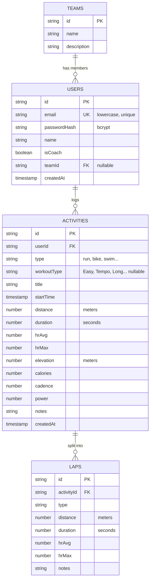
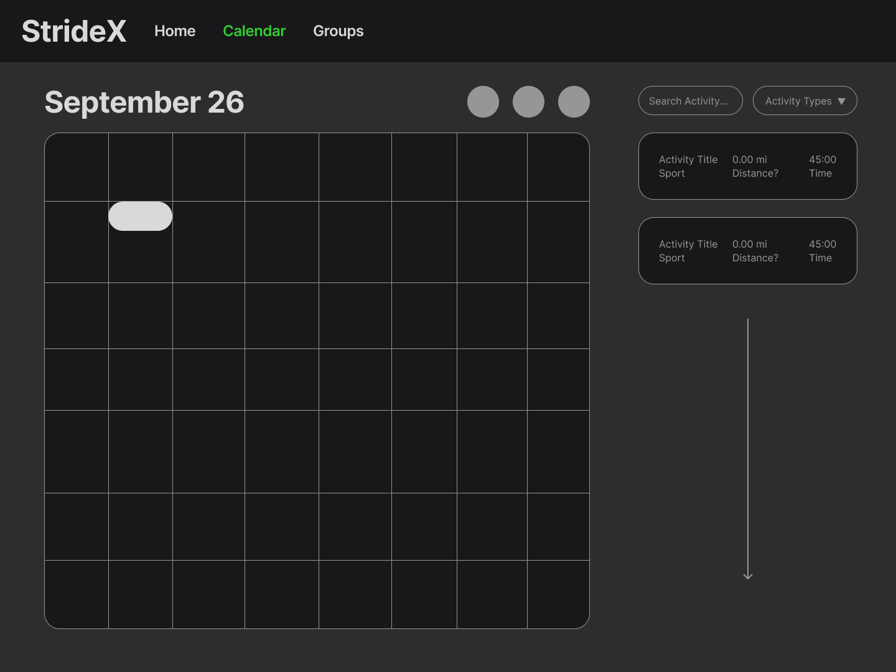
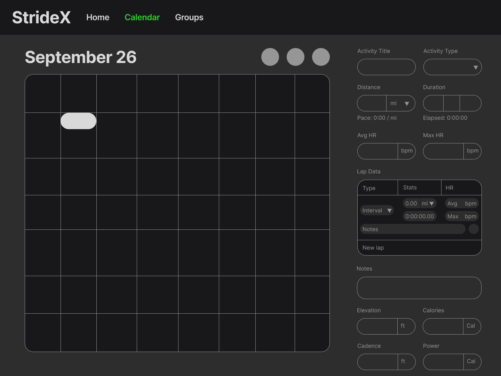

<h1>
  
  Training
</h1>

A training calendar that allows users to organize activities and coaches to view and analyze activities and data. This application is intended for athletes and coaches to track training progress and performance, as well as casual athletes who are interested in being involved in clubs.

## Features
- **Accounts** — Register and log in. Passwords are hashed with bcrypt and sessions use signed JWTs

- **Training Calendar** — Each user's activities load from the database onto a calendar with weekly totals

- **Create & Edit Activities** — Add an activity (with laps) from the calendar sidebar, or edit a saved one in place

- **File Upload & Manual Entry** — Import Garmin `.fit` / `.csv` exports, or type an activity in by hand

- **Custom Bootstrap Styling** — User interface is styled using modified bootstrap with StrideX branding

## Architecture
```
React + Vite (browser)  ──fetch('/api/...')──▶  Express API (server/)  ──firebase-admin──▶  Cloud Firestore
   src/scripts/api.ts         JSON + JWT          validation, bcrypt,                       users, activities,
                                                  auth middleware                           laps
```
The browser never talks to the database directly. Every read and write goes through the Express API, which checks the login token and validates the request first. During development Vite forwards `/api` requests to the API server.

## Setup
1. Install <a href="https://nodejs.org/en/download">Node.js</a> **22.18 or newer** (the server runs TypeScript directly with Node)

2. Clone the repository into desired folder:
```bash
git clone https://github.com/Etown-CS310/StrideX-Training.git
cd StrideX-Training
```

3. Install dependencies
```bash
npm install
```

4. Configure the database (Firebase / Cloud Firestore)
   1. Create a project in the [Firebase console](https://console.firebase.google.com/) and enable **Cloud Firestore**
   2. Go to **Project settings → Service accounts → Generate new private key**
   3. Save the downloaded file in the project root as `serviceAccount.json` (it is gitignored, never commit it)
   4. Collections are created automatically on first write. Optionally run `npm run seed` to add sample data

5. Set environment variables
```bash
cp .env.example .env
```
   Then edit `.env`:

   | Variable | Required | Description |
   |---|---|---|
   | `JWT_SECRET` | yes | Long random string used to sign login tokens. Generate one with `node -e "console.log(require('crypto').randomBytes(32).toString('hex'))"` |
   | `FIREBASE_SERVICE_ACCOUNT` | no | Path to the service account key (default `serviceAccount.json`) |
   | `PORT` | no | API server port (default `3001`) |

## Running Locally
```bash
npm run dev
```
This starts both the API server (`http://localhost:3001`) and the website (`http://localhost:5173`). Open `http://localhost:5173/`, sign up, and go to **Training**.

| Script | What it does |
|---|---|
| `npm run dev` | API server + Vite dev server together |
| `npm run server` | API server only (restarts on changes) |
| `npm run dev:web` | Front-end only |
| `npm run build` | Type-check everything and build the front-end |
| `npm run seed` | Add sample data to Firestore |
| `npm run stop` | Stop leftover dev servers still holding ports 3001/5173 (also runs automatically before `npm run dev`) |

## Database Design
Cloud Firestore (NoSQL). Each box below is a collection. `laps` is a subcollection stored under each activity document.



| Collection | Purpose |
|---|---|
| `users` | One document per account, stores the bcrypt password hash. `isCoach` and `teamId` support the upcoming coach and group features |
| `teams` | Running clubs and teams that users can belong to |
| `activities` | One workout that belongs to a user through `userId`. Distances are stored in meters and durations in seconds, and the UI converts them for display |
| `activities/{id}/laps` | Splits within an activity (from FIT/CSV files or entered by hand) |

## API Documentation
All endpoints are under `/api`, accept and return JSON, and report errors as `{ "error": "message" }`.
Endpoints marked (auth) need the header `Authorization: Bearer <token>`, using the token returned by register or login.

| Method | Endpoint | Purpose |
|---|---|---|
| `POST` | `/api/register` | Create an account |
| `POST` | `/api/login` | Log in |
| `POST` | `/api/google` | Log in with Google OAuth |
| `GET` | `/api/activities` (auth) | List the logged in user's activities |
| `GET` | `/api/activities/:id` (auth) | Get one activity with its laps |
| `POST` | `/api/activities` (auth) | Create an activity (and its laps) |
| `PATCH` | `/api/activities/:id` (auth) | Update some fields of an activity |
| `DELETE` | `/api/activities/:id` (auth) | Delete an activity and its laps |

<details>
<summary><code>POST /api/register</code> — create an account</summary>

**Body**
```json
{ "email": "runner@example.com", "password": "at-least-8-chars" }
```
**201 Created**
```json
{
  "token": "eyJhbGciOiJIUzI1NiIs...",
  "user": { "id": "Be95hbNDpY6brwC61gKR", "email": "runner@example.com", "name": "runner" }
}
```
| Status | When |
|---|---|
| 201 | Account created |
| 400 | Missing email/password, invalid email, or password under 8 characters |
| 409 | An account with that email already exists |
| 500 | Server error |
</details>

<details>
<summary><code>POST /api/login</code> — log in</summary>

**Body**
```json
{ "email": "runner@example.com", "password": "at-least-8-chars" }
```
**200 OK** — same shape as register (`token` + `user`)

| Status | When |
|---|---|
| 200 | Logged in |
| 400 | Missing email or password |
| 401 | `{ "error": "Incorrect email or password" }` |
| 500 | Server error |
</details>

<details>
<summary><code>POST /api/google</code> — log in with Google OAuth</summary>

**Body**
```json
{ "credential": "google_id_token" }
```
**200 OK** — same shape as register (`token` + `user`)

| Status | When |
|---|---|
| 200 | Logged in |
| 400 | Missing credential |
| 401 | `{ "error": "Google sign-in failed" }` |
| 500 | Server error |
</details>

<details>
<summary><code>GET /api/activities</code> (auth) — list my activities</summary>

**200 OK** (oldest first)
```json
{
  "activities": [
    {
      "id": "HKs3ivETJylUnQnK7rsF",
      "type": "run",
      "workoutType": "Easy",
      "title": "Morning run",
      "startTime": "2026-11-12T12:00:00.000Z",
      "distance": 5000,
      "duration": 1500,
      "hrAvg": 150, "hrMax": 172,
      "elevation": 40, "calories": 350, "cadence": 170, "power": null,
      "notes": ""
    }
  ]
}
```
| Status | When |
|---|---|
| 200 | Success (empty array if none) |
| 401 | Missing, invalid, or expired token |
</details>

<details>
<summary><code>GET /api/activities/:id</code> (auth) — one activity with laps</summary>

**200 OK**
```json
{
  "activity": { "id": "HKs3ivETJylUnQnK7rsF", "title": "Morning run", "...": "..." },
  "laps": [
    { "id": "ttEgmCtLm0QNdejIm3mZ", "type": "active", "distance": 1000, "duration": 300, "hrAvg": 150, "hrMax": 160, "notes": "" }
  ]
}
```
| Status | When |
|---|---|
| 200 | Found |
| 401 | Not logged in |
| 404 | No such activity, or it belongs to another user |
</details>

<details>
<summary><code>POST /api/activities</code> (auth) — create an activity</summary>

**Body** — `activity.title`, `activity.type`, and at least one of `distance`/`duration` are required. Numbers must be non-negative or `null`. `startTime` is an ISO date or `null`.
```json
{
  "activity": {
    "type": "run", "workoutType": "Tempo", "title": "Tuesday tempo",
    "startTime": "2026-11-12T12:00:00.000Z",
    "distance": 8000, "duration": 2400,
    "hrAvg": 160, "hrMax": 178, "elevation": 30, "calories": 520, "cadence": 176, "power": null
  },
  "laps": [ { "type": "active", "distance": 1609, "duration": 420, "hrAvg": 158, "hrMax": 170 } ],
  "notes": "Felt good"
}
```
**201 Created**
```json
{ "activity": { "id": "Qx81...", "title": "Tuesday tempo", "...": "..." } }
```
| Status | When |
|---|---|
| 201 | Created |
| 400 | e.g. `{ "error": "title is required" }`, `{ "error": "distance must be a non-negative number or null" }` |
| 401 | Not logged in |
</details>

<details>
<summary><code>PATCH /api/activities/:id</code> (auth) — update an activity</summary>

**Body** — any subset of the activity fields
```json
{ "title": "Edited run", "distance": 5200 }
```
**200 OK**
```json
{ "activity": { "id": "HKs3ivETJylUnQnK7rsF", "title": "Edited run", "distance": 5200, "...": "..." } }
```
| Status | When |
|---|---|
| 200 | Updated |
| 400 | Invalid field value, or no valid fields sent |
| 401 | Not logged in |
| 404 | No such activity, or it belongs to another user |
</details>

<details>
<summary><code>DELETE /api/activities/:id</code> (auth) — delete an activity</summary>

**200 OK**
```json
{ "deleted": "HKs3ivETJylUnQnK7rsF" }
```
| Status | When |
|---|---|
| 200 | Deleted (laps too) |
| 401 | Not logged in |
| 404 | No such activity, or it belongs to another user |
</details>

Other errors: unknown endpoints return **404** `{ "error": "Endpoint not found" }`, malformed JSON returns **400**, and unexpected failures return **500** `{ "error": "Something went wrong on the server" }`.


## User Interface



## Contributors
- Kaiden Miller - [@kaidenmiller06](https://github.com/kaidenmiller06)
- Brian Duva - [@bjduva456](https://github.com/bjduva456)
- Andrew Arvey - [@LittleDragon78](https://github.com/LittleDragon78)