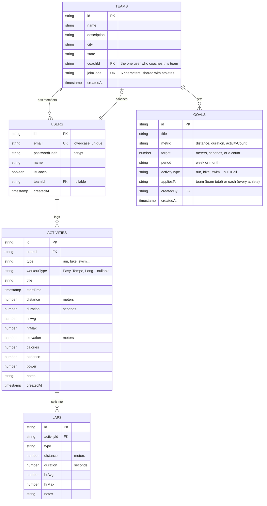
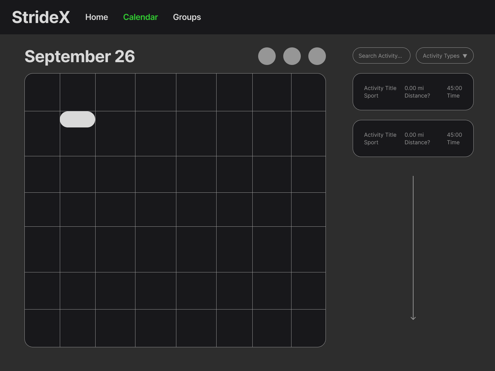
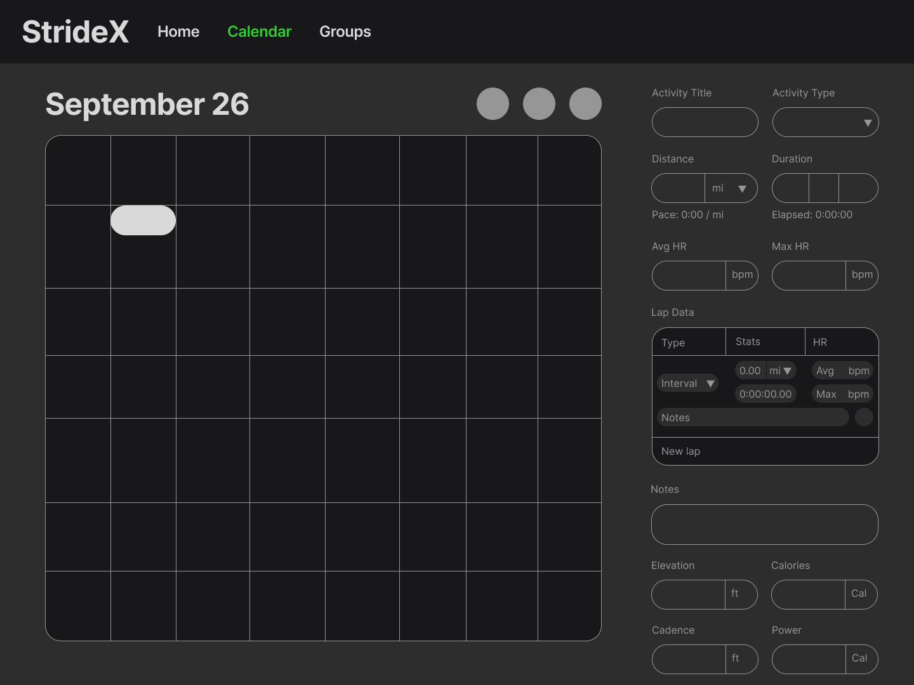

<h1>
  
  Training
</h1>

A training calendar that allows users to organize activities and coaches to view and analyze activities and data. This application is intended for athletes and coaches to track training progress and performance, as well as casual athletes who are interested in being involved in clubs.

## Features
- **Accounts** — Register and log in. Passwords are hashed with bcrypt and sessions use signed JWTs

- **Training Calendar** — Each user's activities load from the database onto a calendar with weekly totals

- **Create & Edit Activities** — Add an activity (with laps) from the calendar sidebar, or edit a saved one in place

- **File Upload & Manual Entry** — Import Garmin `.fit` / `.csv` exports, or type an activity in by hand

- **Coaches & Teams** — Creating a team makes you its coach (one team per coach, transferable). Athletes join with a join code. Coaches can view their athletes' training data, weekly/monthly summaries per athlete or for the whole team, and set measurable team goals

- **Custom Bootstrap Styling** — User interface is styled using modified bootstrap with StrideX branding

## Architecture
```
React + Vite (browser)  ──fetch('/api/...')──▶  Express API (server/)  ──firebase-admin──▶  Cloud Firestore
   src/api/client.ts          JSON + JWT          validation, bcrypt,                       users, activities,
                                                  auth middleware                           laps
```
The browser never talks to the database directly. Every read and write goes through the Express API, which checks the login token and validates the request first. During development Vite forwards `/api` requests to the API server.

## Setup
1. Install <a href="https://nodejs.org/en/download">Node.js</a> **22.18 or newer** (the server runs TypeScript directly with Node)

2. Clone the repository into desired folder:
```bash
git clone https://github.com/Etown-CS310/StrideX-Training.git
cd StrideX-Training
```

3. Install dependencies
```bash
npm install
```

4. Configure the database (Firebase / Cloud Firestore)
   1. Create a project in the [Firebase console](https://console.firebase.google.com/) and enable **Cloud Firestore**
   2. Go to **Project settings → Service accounts → Generate new private key**
   3. Save the downloaded file in the project root as `serviceAccount.json` (it is gitignored, never commit it)
   4. Collections are created automatically on first write. Optionally run `npm run seed` to add sample data

5. Set environment variables
```bash
cp .env.example .env
```
   Then edit `.env`:

   | Variable | Required | Description |
   |---|---|---|
   | `JWT_SECRET` | yes | Long random string used to sign login tokens. Generate one with `node -e "console.log(require('crypto').randomBytes(32).toString('hex'))"` |
   | `FIREBASE_SERVICE_ACCOUNT` | no | Path to the service account key (default `serviceAccount.json`) |
   | `GOOGLE_CLIENT_ID` | for Google sign-in | OAuth client ID the server uses to verify Google logins. Create one in the [Google Cloud Console](https://console.cloud.google.com/apis/credentials) (select the same project as your Firebase project, then **Create Credentials → OAuth client ID → Web application**). Add `http://localhost:5173` as an authorized JavaScript origin. Not secret, but do not confuse it with the Firebase API key |
   | `VITE_GOOGLE_CLIENT_ID` | for Google sign-in | Same value as `GOOGLE_CLIENT_ID`, but prefixed with `VITE_` so the front-end can read it |
   | `PORT` | no | API server port (default `3001`) |

## Running Locally
```bash
npm run dev
```
This starts both the API server (`http://localhost:3001`) and the website (`http://localhost:5173`). Open `http://localhost:5173/`, sign up, and go to **Training**.

| Script | What it does |
|---|---|
| `npm run dev` | API server + Vite dev server together |
| `npm run server` | API server only (restarts on changes) |
| `npm run dev:web` | Front-end only |
| `npm run build` | Type-check everything and build the front-end |
| `npm run seed` | Add sample data to Firestore |
| `npm run stop` | Stop leftover dev servers still holding ports 3001/5173 (also runs automatically before `npm run dev`) |

## Database Design
Cloud Firestore (NoSQL). Each box below is a collection. `laps` is a subcollection stored under each activity document, and `goals` is a subcollection under each team.



| Collection | Purpose |
|---|---|
| `users` | One document per account, stores the bcrypt password hash. `teamId` is the one team the user is on (as coach or athlete). `isCoach` is the coach role flag |
| `teams` | Teams that users belong to. `coachId` decides who coaches it; everyone else on the team is an athlete |
| `teams/{id}/goals` | Measurable weekly/monthly targets set by the coach. Progress is calculated by the summary endpoints |
| `activities` | One workout that belongs to a user through `userId`. Distances are stored in meters and durations in seconds, and the UI converts them for display |
| `activities/{id}/laps` | Splits within an activity (from FIT/CSV files or entered by hand) |

## API Documentation
All endpoints are under `/api`, accept and return JSON, and report errors as `{ "error": "message" }`.
Endpoints marked (auth) need the header `Authorization: Bearer <token>`, using the token returned by register or login.

| Method | Endpoint | Purpose |
|---|---|---|
| `POST` | `/api/register` | Create an account |
| `POST` | `/api/login` | Log in |
| `POST` | `/api/google` | Log in with Google OAuth |
| `GET` | `/api/activities` (auth) | List the logged in user's activities |
| `GET` | `/api/activities/:id` (auth) | Get one activity with its laps |
| `POST` | `/api/activities` (auth) | Create an activity (and its laps) |
| `PATCH` | `/api/activities/:id` (auth) | Update some fields of an activity |
| `DELETE` | `/api/activities/:id` (auth) | Delete an activity and its laps |
| `GET` | `/api/me` (auth) | The logged in user (incl. `isCoach`, `teamId`) |
| `PATCH` | `/api/me` (auth) | Change `name` or `isCoach` |
| `POST` | `/api/team` (auth) | Create a team and become its coach |
| `GET` | `/api/team` (auth, member) | My team, its coach and athletes |
| `GET` | `/api/team/browse` (auth) | Browse all teams |
| `PATCH` | `/api/team` (auth, coach) | Rename / change description |
| `DELETE` | `/api/team` (auth, coach) | Delete the team (members are removed, goals deleted) |
| `POST` | `/api/team/join-code` (auth, coach) | Make a new join code |
| `POST` | `/api/team/join` (auth) | Join a team with a join code |
| `POST` | `/api/team/leave` (auth, athlete) | Leave the team |
| `DELETE` | `/api/team/members/:userId` (auth, coach) | Remove an athlete |
| `POST` | `/api/team/transfer` (auth, coach) | Make another team member the coach |
| `GET` | `/api/team/athletes/:athleteId/activities` (auth, coach) | An athlete's activities (training calendar data) |
| `GET` | `/api/team/athletes/:athleteId/activities/:activityId` (auth, coach) | One of an athlete's activities with laps |
| `GET` | `/api/team/athletes/:athleteId/summary` (auth, coach) | Weekly/monthly summary for one athlete |
| `GET` | `/api/team/summary` (auth, coach) | Weekly/monthly summary for the whole team |
| `GET` | `/api/team/goals` (auth, member) | List team goals |
| `POST` | `/api/team/goals` (auth, coach) | Create a goal |
| `PATCH` | `/api/team/goals/:goalId` (auth, coach) | Edit a goal |
| `DELETE` | `/api/team/goals/:goalId` (auth, coach) | Delete a goal |

**Roles:** "member" = anyone on the team, "coach" = the team's `coachId`, "athlete" = a member who isn't the coach. Coach-only routes return **403** to athletes, and team routes return **404** `{ "error": "You are not on a team" }` when the user has no team. Coaches can only *read* athlete data; the `/api/activities` routes stay owner-only.

Register, login, and Google responses now return `user` as `{ id, email, name, isCoach, teamId }`. Register also accepts an optional `"isCoach": true`.

<details>
<summary><code>POST /api/register</code> — create an account</summary>

**Body**
```json
{ "email": "runner@example.com", "password": "at-least-8-chars" }
```
**201 Created**
```json
{
  "token": "eyJhbGciOiJIUzI1NiIs...",
  "user": { "id": "Be95hbNDpY6brwC61gKR", "email": "runner@example.com", "name": "runner" }
}
```
| Status | When |
|---|---|
| 201 | Account created |
| 400 | Missing email/password, invalid email, or password under 8 characters |
| 409 | An account with that email already exists |
| 500 | Server error |
</details>

<details>
<summary><code>POST /api/login</code> — log in</summary>

**Body**
```json
{ "email": "runner@example.com", "password": "at-least-8-chars" }
```
**200 OK** — same shape as register (`token` + `user`)

| Status | When |
|---|---|
| 200 | Logged in |
| 400 | Missing email or password |
| 401 | `{ "error": "Incorrect email or password" }` |
| 500 | Server error |
</details>

<details>
<summary><code>POST /api/google</code> — log in with Google OAuth</summary>

**Body**
```json
{ "credential": "google_id_token" }
```
**200 OK** — same shape as register (`token` + `user`)

| Status | When |
|---|---|
| 200 | Logged in |
| 400 | Missing credential |
| 401 | `{ "error": "Google sign-in failed" }` |
| 500 | Server error |
</details>

<details>
<summary><code>GET /api/activities</code> (auth) — list my activities</summary>

**200 OK** (oldest first)
```json
{
  "activities": [
    {
      "id": "HKs3ivETJylUnQnK7rsF",
      "type": "run",
      "workoutType": "Easy",
      "title": "Morning run",
      "startTime": "2026-11-12T12:00:00.000Z",
      "distance": 5000,
      "duration": 1500,
      "hrAvg": 150, "hrMax": 172,
      "elevation": 40, "calories": 350, "cadence": 170, "power": null,
      "notes": ""
    }
  ]
}
```
| Status | When |
|---|---|
| 200 | Success (empty array if none) |
| 401 | Missing, invalid, or expired token |
</details>

<details>
<summary><code>GET /api/activities/:id</code> (auth) — one activity with laps</summary>

**200 OK**
```json
{
  "activity": { "id": "HKs3ivETJylUnQnK7rsF", "title": "Morning run", "...": "..." },
  "laps": [
    { "id": "ttEgmCtLm0QNdejIm3mZ", "type": "active", "distance": 1000, "duration": 300, "hrAvg": 150, "hrMax": 160, "notes": "" }
  ]
}
```
| Status | When |
|---|---|
| 200 | Found |
| 401 | Not logged in |
| 404 | No such activity, or it belongs to another user |
</details>

<details>
<summary><code>POST /api/activities</code> (auth) — create an activity</summary>

**Body** — `activity.title`, `activity.type`, and at least one of `distance`/`duration` are required. Numbers must be non-negative or `null`. `startTime` is an ISO date or `null`.
```json
{
  "activity": {
    "type": "run", "workoutType": "Tempo", "title": "Tuesday tempo",
    "startTime": "2026-11-12T12:00:00.000Z",
    "distance": 8000, "duration": 2400,
    "hrAvg": 160, "hrMax": 178, "elevation": 30, "calories": 520, "cadence": 176, "power": null
  },
  "laps": [ { "type": "active", "distance": 1609, "duration": 420, "hrAvg": 158, "hrMax": 170 } ],
  "notes": "Felt good"
}
```
**201 Created**
```json
{ "activity": { "id": "Qx81...", "title": "Tuesday tempo", "...": "..." } }
```
| Status | When |
|---|---|
| 201 | Created |
| 400 | e.g. `{ "error": "title is required" }`, `{ "error": "distance must be a non-negative number or null" }` |
| 401 | Not logged in |
</details>

<details>
<summary><code>PATCH /api/activities/:id</code> (auth) — update an activity</summary>

**Body** — any subset of the activity fields
```json
{ "title": "Edited run", "distance": 5200 }
```
**200 OK**
```json
{ "activity": { "id": "HKs3ivETJylUnQnK7rsF", "title": "Edited run", "distance": 5200, "...": "..." } }
```
| Status | When |
|---|---|
| 200 | Updated |
| 400 | Invalid field value, or no valid fields sent |
| 401 | Not logged in |
| 404 | No such activity, or it belongs to another user |
</details>

<details>
<summary><code>DELETE /api/activities/:id</code> (auth) — delete an activity</summary>

**200 OK**
```json
{ "deleted": "HKs3ivETJylUnQnK7rsF" }
```
| Status | When |
|---|---|
| 200 | Deleted (laps too) |
| 401 | Not logged in |
| 404 | No such activity, or it belongs to another user |
</details>

<details>
<summary><code>GET</code> / <code>PATCH /api/me</code> (auth) — current user</summary>

**PATCH body** — any of
```json
{ "name": "Coach Kim", "isCoach": true }
```
**200 OK**
```json
{ "user": { "id": "Be95hbNDpY6brwC61gKR", "email": "kim@example.com", "name": "Coach Kim", "isCoach": true, "teamId": "T7x..." } }
```
| Status | When |
|---|---|
| 200 | Success |
| 400 | Invalid or no fields |
| 401 | Not logged in |
| 409 | `isCoach: false` while coaching a team (transfer or delete the team first) |
</details>

<details>
<summary><code>POST /api/team</code> (auth) — create a team and become its coach</summary>

**Body**
```json
{ "name": "Etown XC", "description": "Cross country", "city": "Elizabethtown", "state": "PA" }
```
**201 Created**
```json
{ "team": { "id": "T7x...", "name": "Etown XC", "description": "Cross country", "coachId": "Be95...", "city": "Elizabethtown", "state": "PA", "joinCode": "K7PQ2M", "createdAt": "2026-11-20T15:00:00.000Z" } }
```
| Status | When |
|---|---|
| 201 | Created; the caller's `teamId` is set and `isCoach` becomes `true` |
| 400 | Missing name, or name/description/city/state too long |
| 409 | Already on a team (a user can only be on, or coach, one team) |
</details>

<details>
<summary><code>GET /api/team</code> (auth, member) — my team</summary>

**200 OK** (`joinCode` and member `email`s are only included for the coach)
```json
{
  "team": { "id": "T7x...", "name": "Etown XC", "description": "", "coachId": "Be95...", "city": "Elizabethtown", "state": "PA", "joinCode": "K7PQ2M", "createdAt": "..." },
  "coach": { "id": "Be95...", "name": "Coach Kim", "email": "kim@example.com" },
  "athletes": [ { "id": "aQ1...", "name": "Alice", "email": "alice@example.com" } ],
  "viewerIsCoach": true
}
```
| Status | When |
|---|---|
| 200 | Success |
| 404 | Not on a team |
</details>

<details>
<summary><code>GET /api/team/browse</code> (auth) — browse all teams</summary>

**200 OK** (`joinCode` is only included for teams the caller coaches)
```json
{
  "teams": [
    { "id": "T7x...", "name": "Etown XC", "description": "Cross country", "city": "Elizabethtown", "state": "PA", "members": 12, "isMember": true, "isCoach": true, "joinCode": "K7PQ2M", "createdAt": "2026-11-20T15:00:00.000Z" },
    { "id": "U2k...", "name": "Harrisburg Runners", "description": "", "city": "Harrisburg", "state": "PA", "members": 40, "isMember": false, "isCoach": false, "createdAt": "2026-11-18T12:00:00.000Z" }
  ]
}
```
| Status | When |
|---|---|
| 200 | Success |
| 401 | Not logged in |
</details>

<details>
<summary><code>POST /api/team/join</code> (auth) — join with a code</summary>

**Body** (not case sensitive)
```json
{ "code": "K7PQ2M", "teamId": "T7x..." }
```
**200 OK** — `{ "team": { ... } }` (no join code)

| Status | When |
|---|---|
| 200 | Joined as an athlete |
| 400 | Missing code |
| 404 | No team has that code or the code is not for this team |
| 409 | Already on a team |
</details>

<details>
<summary>Other membership routes (<code>leave</code>, <code>members/:userId</code>, <code>transfer</code>, <code>join-code</code>, <code>PATCH</code>/<code>DELETE /api/team</code>)</summary>

| Request | Response |
|---|---|
| `POST /api/team/leave` | `{ "left": teamId }`. **409** for the coach (transfer or delete first) |
| `DELETE /api/team/members/:userId` | `{ "removed": userId }`. **404** if not an athlete on the team |
| `POST /api/team/transfer` body `{ "userId": "aQ1..." }` | `{ "team": {...} }`. The athlete becomes coach (`isCoach: true`); the old coach stays on the team as an athlete (`isCoach: false`). **404** if not an athlete on the team |
| `POST /api/team/join-code` | `{ "joinCode": "N3WC0D" }`; the old code stops working |
| `PATCH /api/team` body `{ "name"?, "description"? }` | `{ "team": {...} }` |
| `DELETE /api/team` | `{ "deleted": teamId }`; every member's `teamId` becomes `null` and goals are deleted |
</details>

<details>
<summary><code>GET /api/team/athletes/:athleteId/activities</code> (auth, coach) — an athlete's training data</summary>

Optional query `from` / `to` (ISO dates, `to` exclusive). Activities use the same shape as `GET /api/activities`. `GET /api/team/athletes/:athleteId/activities/:activityId` returns `{ activity, laps }` like `GET /api/activities/:id`.

**200 OK**
```json
{
  "athlete": { "id": "aQ1...", "name": "Alice", "email": "alice@example.com" },
  "activities": [ { "id": "HKs3...", "type": "run", "title": "Morning run", "startTime": "2026-11-17T12:00:00.000Z", "distance": 10000, "duration": 3000, "...": "..." } ]
}
```
| Status | When |
|---|---|
| 200 | Success |
| 400 | Bad `from`/`to` |
| 403 | Caller isn't the coach |
| 404 | That user isn't an athlete on your team (or activity not found) |
</details>

<details>
<summary><code>GET /api/team/summary</code> and <code>/api/team/athletes/:athleteId/summary</code> (auth, coach) — weekly/monthly summaries</summary>

**Query**
| Param | Default | Meaning |
|---|---|---|
| `period` | `week` | `week` (Monday–Sunday) or `month` |
| `date` | today | `YYYY-MM-DD`; the summary covers the week/month containing it |
| `tzOffset` | `0` | The browser's `new Date().getTimezoneOffset()` so periods line up with the user's local calendar |

Totals (`team`, each `athletes[].totals`, and the athlete summary's `totals`) look like:
```json
{
  "activityCount": 3, "distance": 44000, "duration": 8100, "elevation": 0, "calories": 0,
  "hrAvg": 150,
  "byType": { "run": { "activityCount": 2, "distance": 14000, "duration": 4500 }, "bike": { "activityCount": 1, "distance": 30000, "duration": 3600 } }
}
```
`hrAvg` is weighted by duration (`null` if no heart rate data). Each goal is measured over **its own** period (the week or month containing `date`), whatever `period` the summary uses.

**Team summary 200 OK**
```json
{
  "period": { "period": "week", "startDate": "2026-11-16", "start": "2026-11-16T05:00:00.000Z", "end": "2026-11-23T05:00:00.000Z" },
  "team": { "activityCount": 3, "distance": 44000, "...": "..." },
  "athletes": [ { "id": "aQ1...", "name": "Alice", "email": "...", "totals": { "...": "..." } } ],
  "goals": [
    {
      "goal": { "id": "g1", "title": "Team 12k run", "metric": "distance", "target": 12000, "period": "week", "activityType": "run", "appliesTo": "team", "...": "..." },
      "period": { "...": "..." },
      "current": 14000,
      "met": true,
      "athletesMet": null,
      "athletes": [ { "id": "aQ1...", "name": "Alice", "current": 10000, "met": null } ]
    }
  ]
}
```
For `appliesTo: "team"`, `current` is the team total and `met` compares it to `target`. For `appliesTo: "each"`, every athlete has their own `met`, `athletesMet` counts them, and the goal is `met` when all athletes are.

**Athlete summary 200 OK** — `{ period, athlete, totals, goals: [{ goal, period, current, met }] }`, where `met` is `null` for team-total goals.

| Status | When |
|---|---|
| 200 | Success |
| 400 | Bad `period`, `date`, or `tzOffset` |
| 403 | Caller isn't the coach |
| 404 | Not on a team, or athlete not on your team |
</details>

<details>
<summary><code>/api/team/goals</code> — team goals</summary>

**POST body** (coach). `activityType` (default `null` = all types) and `appliesTo` (default `team`) are optional.
```json
{ "title": "Run 20 km as a team", "metric": "distance", "target": 20000, "period": "week", "activityType": "run", "appliesTo": "team" }
```
`metric`: `distance` (meters), `duration` (seconds), or `activityCount`. `target` must be a positive number.

| Request | Response |
|---|---|
| `GET /api/team/goals` (any member) | `{ "goals": [ { "id", "title", "metric", "target", "period", "activityType", "appliesTo", "createdBy", "createdAt" } ] }` |
| `POST /api/team/goals` | **201** `{ "goal": {...} }`, **400** on invalid fields |
| `PATCH /api/team/goals/:goalId` (any subset of fields) | `{ "goal": {...} }`, **404** if missing |
| `DELETE /api/team/goals/:goalId` | `{ "deleted": goalId }`, **404** if missing |
</details>

Other errors: unknown endpoints return **404** `{ "error": "Endpoint not found" }`, malformed JSON returns **400**, and unexpected failures return **500** `{ "error": "Something went wrong on the server" }`.


## User Interface



## Contributors
- Kaiden Miller - [@kaidenmiller06](https://github.com/kaidenmiller06)
- Brian Duva - [@bjduva456](https://github.com/bjduva456)
- Andrew Arvey - [@LittleDragon78](https://github.com/LittleDragon78)